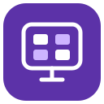
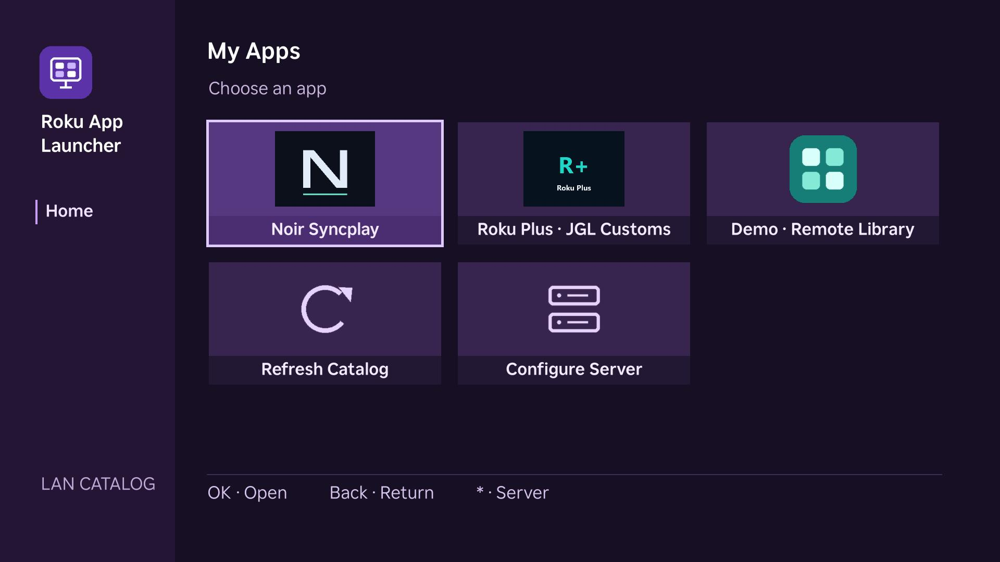
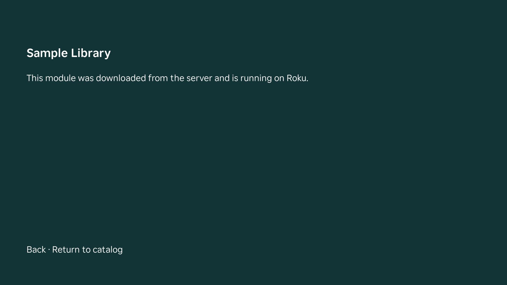

<p align="center">
  
</p>
<h1 align="center">Roku App Launcher</h1>
<p align="center">A Roku-style app grid for your own SceneGraph catalog.</p>

<p align="center">
  
</p>

One development channel, a catalog you host, and multiple compatible SceneGraph libraries. Use your Roku remote to switch between apps. A server address saved on the TV survives closing and reopening the launcher.

Roku allows [one sideloaded development channel](https://developer.roku.com/dev/docs/developer-setup) at a time. The launcher occupies that slot. It downloads [SceneGraph component libraries](https://developer.roku.com/dev/docs/componentlibrary); it cannot run another channel's original ZIP or call its standalone `Main()`. For modules, conversion recipes, and a copy-and-paste AI prompt, see [Roku Launcher Apps](https://github.com/neura-neura/roku-launcher-apps).

## Quick start

1. On a computer or server on the Roku's LAN, install Python 3.10 or newer. Clone this repository.
2. Download `roku-app-launcher.zip` and `server-demo.zip` from [Releases](https://github.com/neura-neura/roku-app-launcher/releases). Extract the server bundle **at the repository root** so that it creates `dist/server/catalog.json`, `dist/server/apps/`, and `dist/server/icons/`.
3. Find the server's private LAN IPv4 address (for example, `192.168.1.10`). Run this command from the repository root and leave the process running:

   ```sh
   python3 serve.py --bind 192.168.1.10 --port 8765
   ```

4. From another device on the same LAN, open `http://192.168.1.10:8765/catalog.json`. If it does not respond, check the address and allow TCP 8765 through the server's LAN firewall. Use a DHCP reservation if you want the IP to stay fixed.
5. Enable [Roku developer mode](https://developer.roku.com/dev/docs/developer-setup). Keep the original ZIP of any development channel you want to restore. Open the Roku's IP address in a browser, sign into the Development Application Installer, and upload `roku-app-launcher.zip`. This replaces the current development channel.
6. On the TV, select **Configure Server** (or press **\***), enter `192.168.1.10:8765`, and select **Save**. The demo should appear. Open it, then use **Back** to return to the catalog.

The server needs to be running whenever the Roku fetches the catalog or opens a library it has not loaded. You can use an existing HTTP server instead: use `dist/server/` as its document root and serve `/catalog.json`, `/apps/*.zip`, and `/icons/*`. Use a trusted LAN or HTTPS with a certificate the Roku trusts. The Roku runs the libraries you publish, so only add code you trust. The built-in server binds to the private IPv4 address you specify and does not require the Roku's developer credentials. Do not forward its port to the public Internet.

## Add apps

Copy compatible library ZIPs into `dist/server/apps/` and add entries to `dist/server/catalog.json` in the order you want. Use **Refresh Catalog** on the TV. You do not have to reinstall the launcher for ordinary library updates. Use a new library ID and filename per revision, and keep `sg_component_libs_provided` in the library manifest equal to the ID.

```json
{
  "version": 1,
  "apps": [
    {
      "title": "My App",
      "id": "MyApp_v1",
      "component": "Start",
      "path": "/apps/MyApp_v1.zip",
      "icon": "/icons/MyApp.png"
    }
  ]
}
```

The optional `icon` is a same-server PNG or JPEG under `dist/server/icons/`. Use a square or landscape image with the logo centered and some clear space around it. The app name is drawn separately below the logo. An older catalog without icons, or an icon that fails to load, shows the app's initial instead. When using `--libraries`, put artwork in that input directory's `icons/` subdirectory.

IDs and component names begin with a letter and can contain letters, numbers, and underscores. The entry component should extend `Group` and give focus to its UI. If it starts timers, tasks, or playback, expose a boolean `running` field: the launcher sets it to true on open and false on exit. The optional `focusRequested` field lets a module focus a child; the optional `dialog` node field delegates a modal to the launcher. Back should bubble to the launcher at the module's root. See the [conversion guide and prompt](https://github.com/neura-neura/roku-launcher-apps).

## Build and run from source

```sh
python3 build.py
python3 serve.py --bind 192.168.1.10
```

The build writes `dist/roku-app-launcher.zip` and `dist/server/`. Use `--server 192.168.1.10:8765` for a prefilled address; a value saved on the TV takes priority. To preserve a custom list across builds, pass `--libraries path/to/libraries`. In that directory, put each library at `<id>.zip` and save a JSON array of entries (the value of `apps` above) as `catalog.json`.

For Noir, use `roku-app-launcher-noir.zip` with `server-noir.zip`, or build with `--noir path/to/noir-roku.zip`. The matching launcher includes the fonts and settings interface Noir needs. Its [Syncplay bridge](https://github.com/neura-neura/syncplay-roku) is separate; configure the bridge URL and key inside Noir. Never publish a paired ZIP, which can contain a personal bridge token. For a locally supplied Roku Plus 1.7.2 ZIP, add `--plus path/to/original.zip`. The module and new catalog can be copied to an already running server without reinstalling the launcher. If you use `--noir` and `--plus` together, the build includes both entries.

<details>
<summary>See a library running on the Roku</summary>



</details>

To restore an original standalone channel, upload its original ZIP through the Development Application Installer. This replaces the launcher. To return, upload the launcher ZIP again.
